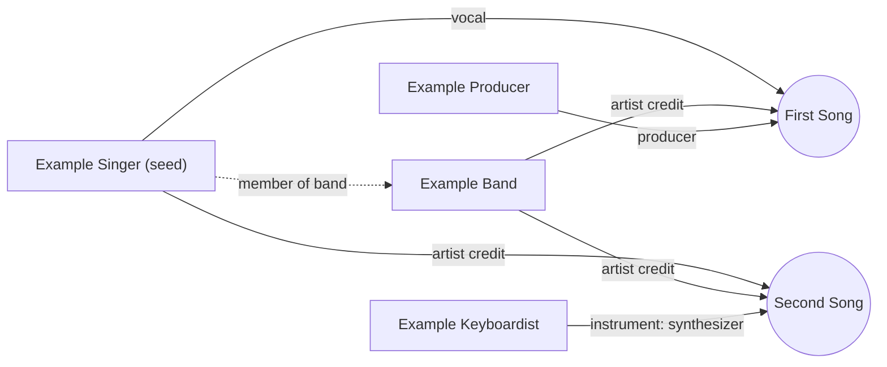

<p align="center">
  <picture>
    <source media="(prefers-color-scheme: dark)" srcset="assets/logo/liner-logo-dark.svg">
    
  </picture>
</p>

<p align="center">
  <strong>Explore music through the people behind it.</strong>
</p>

<p align="center">
  
  
  
  
</p>

Liner takes its name from liner notes, the text on a record sleeve that says who played, produced and engineered each track. Liner follows those credits. Many recommenders answer "fans of X also like Y" with a score and no explanation. Liner links artists through the people between them, and every link can be checked against the open database it came from.

> **Early stage.** The data layer and the scoring are built and tested on invented data. The radio, the interface and the first live run against MusicBrainz are still to come. See [Status and limits](#status-and-limits).

**Contents:** [Why Liner](#why-liner) · [Example](#example) · [How it works](#how-it-works) · [Getting started](#getting-started) · [Commands](#commands) · [Data and licences](#data-and-licences) · [Roadmap](#roadmap) · [Status and limits](#status-and-limits) · [Development](#development) · [Licence](#licence)

## Why Liner

- **Explainable.** Each suggestion lists its evidence: the shared recordings, the roles people had on them, direct links such as band membership, and how far apart the artists are in time.
- **Open data only.** Built on MusicBrainz core data (CC0). No Spotify recommendation or audio-feature APIs.
- **Local first.** No accounts and no analytics. The only network traffic is lookups to MusicBrainz, and every response is cached on your machine.
- **No trained models.** Scores are simple weights you can read and change.
- **Honest about taste.** Liner does not claim to understand your taste. It shows how confident it is and lets you correct it.

## Example

Output of `liner neighbours` on a small invented graph, with Example Singer as the seed artist:

```text
Example Band [b0000000-0000-0000-0000-000000000002]  score 0.85, confidence 100%
    shared 2 recording(s) as artist credit: First Song, Second Song
    linked: member of band
    era: 2000 vs 2000
Example Producer [c0000000-0000-0000-0000-000000000003]  score 0.62, confidence 100%
    shared 1 recording(s) as producer: First Song
    era: 1999 vs 2000
Example Keyboardist [d0000000-0000-0000-0000-000000000004]  score 0.40, confidence 100%
    shared 1 recording(s) as instrument: Second Song
    era: 2001 vs 2000
```

Example Band ranks first. It shares two recordings with the seed, has a direct band membership, and comes from the same years. The producer and the keyboardist each share one recording, and each reason says what the connection is. Confidence is 100% because every factor had data behind it.

## How it works

Liner stores an artist's credits as a graph. Artists sit on one side, recordings on the other, and every credit carries a role. Two artists are neighbours when they share a recording or have a direct link. Every reason is read straight from the stored data.



Arrows point from an artist to a recording they are credited on. The dotted line is a direct link between two artists.

1. **Crawl.** `liner crawl` fetches an artist, up to 50 of their recordings by default, and everyone credited on those recordings. Release years come with the recordings.
2. **Connect.** Artists who share a recording, or who have a direct relation, become neighbours. Artists two steps away can be reached too.
3. **Explain.** `liner neighbours` prints each suggestion with its score, its confidence and the evidence for it.

### How a score is built

Each candidate is scored on five factors, and the score is their weighted average. Credits and path are scaled so the best candidate scores 1 on each. The other factors are already between 0 and 1.

| Factor | What it measures | Starting weight |
| --- | --- | --- |
| Credits | Shared recordings. Each credit is weighted by its role, rare instruments count more than common ones, and big recordings and prolific artists count for less. | 1.0 |
| Path | How much of a random walk from the seed lands on the artist, so artists two steps away can appear. | 0.6 |
| Link | A direct relation, such as band membership. | 0.8 |
| Era | How close the two artists' median release years are. | 0.4 |
| Familiarity | How much of the stored catalogue an artist has, compared with a target. Off until there is a popularity signal worth trusting. | 0 |

**Confidence** is the share of the weighting that had data behind it, so a suggestion built without release years says so. The list is spread out with maximal marginal relevance, so near-duplicates are not listed together.

Feedback nudges the weights. `liner feedback like` or `liner feedback skip` moves each factor that drove a suggestion by a small, fixed step, within fixed bounds. Nothing is trained. `liner profile` shows the weights, and `liner profile reset` restores the defaults.

## Radio (planned)

Liner's flagship feature is Radio: type a song or an album and get an endless stream of suggestions, each with a reason. Radio is not built yet. The planned pipeline:

1. **Seed resolution.** Match the typed song or album to a MusicBrainz ID with fuzzy search. An album seed is the combined profile of its tracks.
2. **Candidate generation.** Collect artists and recordings from the credits graph, from shared genres and tags (subject to the [licence check](docs/licences.md)), and from co-listening data once the ListenBrainz licence is verified.
3. **Scoring.** Weighted similarity across genre, era, tempo, key and mode, energy, credits and obscurity. Each score comes with a plain-language reason. Genre, tempo, key and energy are not built yet.
4. **Diversity.** Re-rank so the list does not repeat near-identical tracks (MMR-style re-ranking). This is built for artists already.
5. **Sequencing.** Order tracks so that tempo, key and energy change smoothly.
6. **Live feedback.** Skips and likes adjust the weights for the current session. Feedback is built, but it is saved to the profile rather than kept per session.

## Features

**Works today**

- Search for an artist on MusicBrainz by name.
- Crawl an artist into a local SQLite file: recordings, credits, direct artist links and release years. `--expand` also crawls the artists most closely credited with them.
- Score each suggestion on five factors, with a confidence, the reasons, and any missing data (see [How a score is built](#how-a-score-is-built)).
- Spread the list out, so near-duplicates are not listed together.
- Like or skip a suggestion, and show or reset the weights with `profile`.
- Measure suggestions against a hand-built seeds file with `eval` (see [docs/evaluation.md](docs/evaluation.md)).
- Cache every MusicBrainz response, so repeating a crawl makes no network requests.
- Keep within MusicBrainz's rate limit, and retry 503 responses with backoff.

**Planned**

- Radio. The familiarity factor is in place but stays off until there is a popularity signal worth trusting.
- Bridge mode: the shortest chain of collaborators between two artists.
- Full "why this" paths that show the whole chain, not just the last step.
- A listening queue built from links and embeds (no hosted audio), and export of finds as a playlist file.
- Import of your own listening history (ListenBrainz, Last.fm or a streaming export), processed on your machine.
- BPM and key from your own audio files, using open-source analysis.
- An editable taste profile with context modes such as study, workout and night.

## Getting started

### Requirements

- Python 3.11 or newer. Developed on 3.13.
- Nothing else: the project has no third-party dependencies.

### Install

Windows (PowerShell):

```powershell
python -m venv .venv
.venv\Scripts\Activate.ps1
python -m pip install -e .
```

macOS or Linux:

```bash
python -m venv .venv
source .venv/bin/activate
python -m pip install -e .
```

To run without installing, set `PYTHONPATH=src` and use `python -m liner` in place of `liner`.

### Set a contact

MusicBrainz asks every client to identify itself. Liner sends `Liner/<version> (<contact>)` as its User-Agent, using the `LINER_CONTACT` environment variable. A project URL is better than an email address, because the contact is sent with every request.

```powershell
$env:LINER_CONTACT = "https://example.org/your-project"
```

Commands that call MusicBrainz refuse to run without a contact. Commands that only read local data do not need one.

### First run

```powershell
liner search "Radiohead"
liner crawl <artist-mbid> --expand 5
liner neighbours <artist-mbid>
```

Use the ID that `search` prints in place of `<artist-mbid>`.

## Commands

| Command | What it does | Network |
| --- | --- | --- |
| `liner search NAME [--limit N]` | Find artists by name and print their MusicBrainz IDs | Yes |
| `liner crawl MBID [--max-recordings N] [--expand N]` | Store an artist, up to N of their recordings (default 50), their credits and direct links. `--expand` also crawls the N artists most closely credited with them. | Yes |
| `liner neighbours MBID [--limit N] [--no-diversify]` | List suggestions for an artist, each with its score, confidence and reasons | No |
| `liner feedback {like,skip} SEED ARTIST` | Like or skip a suggestion, nudging the weights | No |
| `liner profile`, `liner profile set NAME VALUE`, `liner profile reset` | Show, change or reset the factor weights | No |
| `liner eval SEEDS [--k N] [--ablate]` | Measure suggestions against a hand-built seeds file | No |
| `liner stats` | Count what is stored locally | No |

Every command accepts `--db FILE`.

## Configuration

| Variable | Purpose | Default |
| --- | --- | --- |
| `LINER_CONTACT` | Contact in the User-Agent. Required by commands that call MusicBrainz. | none |
| `LINER_DB` | Path to the SQLite database | `data/liner.sqlite` |

## Rate limits and caching

- Liner sends at most one request per second, the average MusicBrainz allows per IP address.
- A 429 or 503 response is retried after 1, 2 and 4 seconds. If it still fails, the command stops with an error.
- Every response is stored in the database under its URL. A repeated crawl makes no network requests, and an interrupted crawl resumes from the cache.
- The cost of a first crawl is one request per recording, so 50 recordings take about a minute. `--expand` multiplies that cost by the number of artists it adds.

## Project layout

```text
src/liner/
  musicbrainz.py   cached, rate-limited client for the WS/2 API
  store.py         SQLite schema and writes
  crawl.py         artist -> recordings, credits, links and neighbours
  scoring.py       the five factors, confidence, reasons and diverse selection
  profile.py       factor weights and bounded feedback
  evaluate.py      precision, recall, coverage and ablations
  cli.py           the `liner` command
tests/             unit tests, no network access
docs/              licences, decisions, evaluation, interview notes
assets/logo/       logo files
```

## Development

Run the tests from the project folder:

```powershell
python -m unittest
```

If the package is not installed, set `$env:PYTHONPATH = "src"` first. The tests use invented fixtures shaped like MusicBrainz responses, so they never touch the network. The first live crawl will confirm the field names against real responses.

## Data and licences

Liner does not ship any MusicBrainz data. It fetches what it needs at runtime and keeps it in your local cache.

| Source | Used for | Licence |
| --- | --- | --- |
| MusicBrainz core data: artists, recordings, credits, links, release dates | The credits graph and the era factor | CC0 (verified) |
| MusicBrainz tags, genres, ratings | Not used yet | CC BY-NC-SA 3.0 (verified) |
| ListenBrainz listens | Planned, Phase 5 | Unverified. Secondary sources say CC0. |

Data from [MusicBrainz](https://musicbrainz.org). Full details and what was checked: [docs/licences.md](docs/licences.md).

## Roadmap

| Phase | Scope | Status |
| --- | --- | --- |
| 1 | Data pipeline: a MusicBrainz subset and the credits graph | In progress. Client, store, crawl (with expansion) and CLI are built and tested on fixtures. The first live run is pending. |
| 2 | Search, artist and credit pages | Planned |
| 3 | "Why this" paths and transparent scoring | In progress. Five factors, confidence, reasons, diverse selection and feedback are built and tested. Measuring them needs a live crawl and a seeds file. |
| 4 | Bridge mode: shortest chain of collaborators | Planned |
| 5 | Familiarity slider with ListenBrainz data | Planned. Licence to verify first. |
| 6 | Listening queue and export | Planned |
| 7 | Tests, docs and open-source release | Started. Unit tests and docs exist. |

## Evaluation

Suggestions are measured against a list you write by hand. The tool is built; see [docs/evaluation.md](docs/evaluation.md). The brief's measures are:

1. A hand-built set of 30 or more seed artists, each with known good neighbours.
2. Held-out co-listens: does the radio surface tracks people actually listened to together?
3. A blind test with friends: the radio against a random same-genre baseline.
4. Skip rate in sessions, read as a sign of mismatch rather than a target.

## Status and limits

- The first live crawl has not run yet, so the example above is invented data.
- A crawl reads the first recordings that MusicBrainz lists for an artist, so neighbours come from a sample. `--expand` adds a second ring of artists.
- Credits are only as complete as MusicBrainz's editing. Many producers and engineers are not recorded.
- The weights are starting guesses. They are not tuned yet, and the evaluation is what should tune them.
- Artist names are not disambiguated yet. Use the MusicBrainz ID.

Decisions taken so far, and the open questions, are in [docs/decisions.md](docs/decisions.md).

## Contributing

Liner is not open to outside contributions yet. The licence has not been chosen and there is no public repository. Guidelines will come with the first public release.

## Licence

No licence has been chosen yet, so the code is not licensed for reuse. A licence file will be added once the contributor terms have been checked.

## Acknowledgements

- [MusicBrainz](https://musicbrainz.org) and the MetaBrainz Foundation, whose open core data makes the credits graph possible.

## About the logo

The mark is a stack of fifteen traces of one tone, each shifted a little in time. The tone changes across the mark, from a pure sine on the left to the full tone on the right, so the stack moves from familiar to complex. Each layer hides the one behind it, which gives the stack its depth. The files are in [assets/logo](assets/logo), and `stacked_waveforms.py` in that folder regenerates them: `python assets/logo/stacked_waveforms.py --publish morph-15 --logo-dir assets/logo`.
